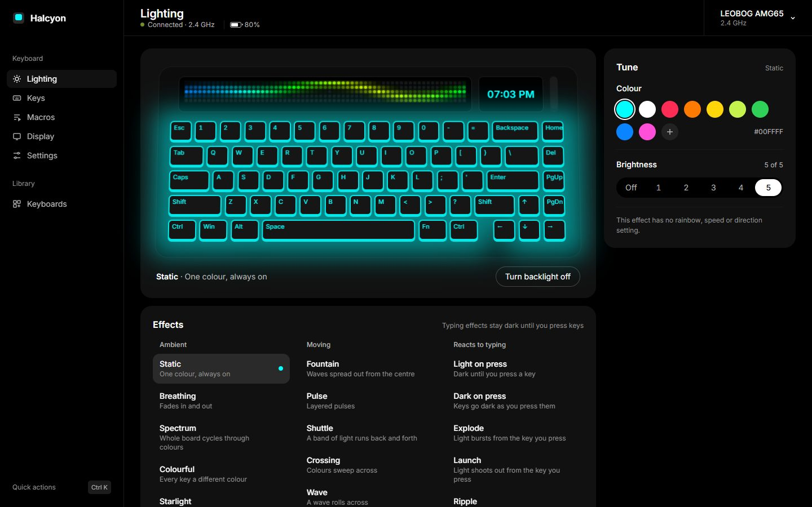
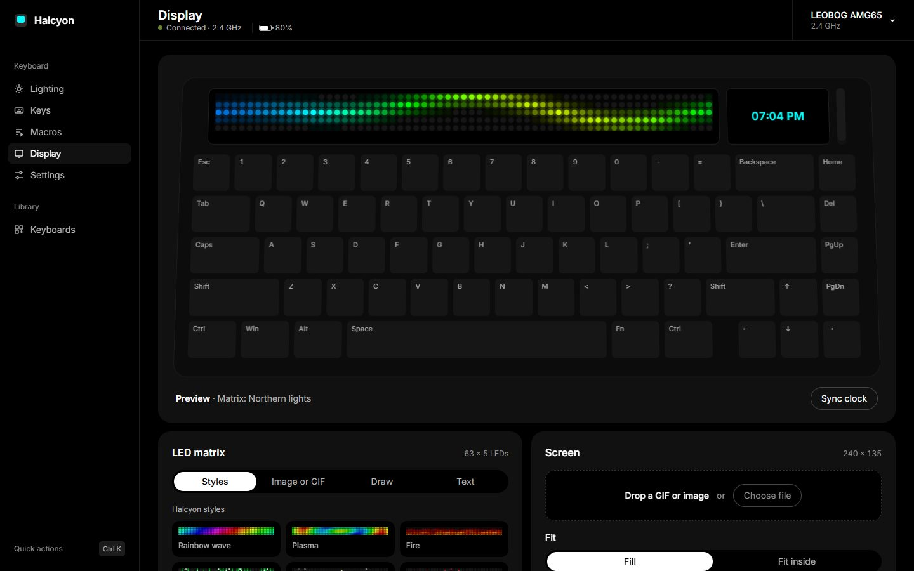

<p align="center"></p>

Halcyon replaces the vendor software for RGB keyboards with one small, fast, open app: lighting, per-key
colours, key remapping, macros, and the LED matrix and screen on boards that have them. It is written in
Rust, ships as a single executable, and talks to keyboards directly over USB. Keyboards are described by small
definition files, so the community can add new ones without touching the code.

It is not affiliated with or endorsed by any keyboard manufacturer.

> [!WARNING]
> **Use at your own risk.** Halcyon talks to keyboards using reverse-engineered protocols that have been tested on
> only a few keyboards. Sending commands, and especially adding or testing new keyboard definitions, could
> misconfigure or brick a keyboard or void its warranty. **You are solely responsible for any damage; the authors
> and contributors accept no responsibility or liability.** Read [DISCLAIMER.md](DISCLAIMER.md) before use. The app
> asks you to accept this once before it sends anything.

<p align="center"></p>

## What it does

- **Lighting**: every built-in effect with its real name, hover to preview, colour, brightness, speed and direction.
- **Per-key colours**: paint each key on a drawing of your keyboard.
- **Keys**: remap any key to another key, a shortcut, a media control, a mouse button or a macro.
- **Macros**: record keystrokes with their timing, edit the steps, store them on the keyboard.
- **LED matrix**: 21 seamless animated styles, GIFs and images, a pixel editor, scrolling text, and the boot animation.
- **Screen**: GIFs and images, or several as a playlist, plus clock sync.
- **Settings**: game mode, key locks, Fn swap and backlight sleep.
- **Quick actions**: press <kbd>Ctrl</kbd> <kbd>K</kbd> to jump to any page, effect or style.

<p align="center"></p>

## Supported keyboards

| Keyboard | Connection | Status |
|---|---|---|
| LEOBOG AMG65 | 2.4 GHz dongle | Lighting, off and per-key colours confirmed on hardware |
| LEOBOG AMG65 | USB cable | LED matrix and screen uploads confirmed on hardware |

Key remapping, macros, settings and clock sync are implemented from the decoded protocol and pass byte-level
tests, but still need confirmation reports from hardware. Bluetooth is not supported. If you try a feature,
please open an issue saying what happened, whether it worked or not.

Want yours on the list? See [CONTRIBUTING.md](CONTRIBUTING.md). Boards that ship the same "HFD" vendor driver
as the AMG65 usually need only a definition file.

## Install

Download the file for your system from the [Releases](../../releases) page:

| System | File | Notes |
|---|---|---|
| Windows 10/11 | `halcyon-windows-x64.exe` | Run it; nothing to install. Uses the WebView2 runtime built into Windows |
| macOS | `halcyon-macos-apple-silicon.zip` or `halcyon-macos-intel.zip` | Unzip and drag Halcyon to Applications. Unsigned: open it the first time with right-click → Open |
| Linux | `halcyon-linux-x64.tar.gz` | Needs WebKitGTK 4.1. Install the included udev rule once so your user can reach the keyboard (see the README inside) |

The macOS and Linux builds are produced by the project's automated builds and have not yet been confirmed
on real hardware. Reports welcome.

### Building from source

Install [Rust](https://rustup.rs) and run `cargo run --release`. Details for each system, including the
Linux packages you need, are in [docs/BUILDING.md](docs/BUILDING.md).

### Other ways to start it

```
halcyon --browser    # use your web browser instead of a window
halcyon --demo       # no keyboard needed: every defined keyboard is simulated, nothing is sent
halcyon --help       # everything else, including the definition and import tools
```

Close the vendor's own software first so the two don't compete for the keyboard.

## Original content from your keyboard

Halcyon ships no vendor files. If you own the vendor software, Halcyon can read a few things from your copy:
a product photo, the factory boot animation and screen (for the Restore buttons) and the factory matrix styles.
See [docs/ORIGINALS.md](docs/ORIGINALS.md).

## Safety

- Halcyon sends only the settings commands the vendor software sends. It contains no firmware flashing.
- **Keys → Reset all keys** restores every key to its factory function.
- Your settings live in `~/.halcyon/` (set `HALCYON_HOME` to move them).
- The window talks to a small server on `127.0.0.1` only, which rejects requests from other websites.

## How it works

```
src/protocol/       one module per protocol family (hfd = Sonix boards with the HFD vendor driver)
src/registry.rs     loads definitions, finds connected keyboards, stores your settings
src/server.rs       local JSON API + the UI, both built into the executable
src/window.rs       the native window (WebView2 on Windows, WebKit on macOS, WebKitGTK on Linux)
devices/*.json      one file per keyboard: USB IDs, effects, layout, features
ui/                 the interface: plain HTML, CSS and JavaScript, no build step
docs/PROTOCOL.md    the reverse-engineered protocol, with detailed specs in docs/protocol/
```

## Contributing

Bug reports, hardware test reports and new keyboards are all welcome. Start with
[CONTRIBUTING.md](CONTRIBUTING.md).

## Licence

[MIT](LICENSE). The bundled Inter typeface is under the SIL Open Font License (`ui/fonts/OFL.txt`).
Product names are trademarks of their owners and are used only to say what Halcyon is compatible with.
